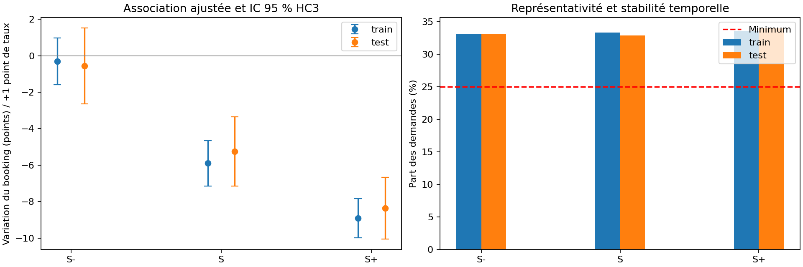
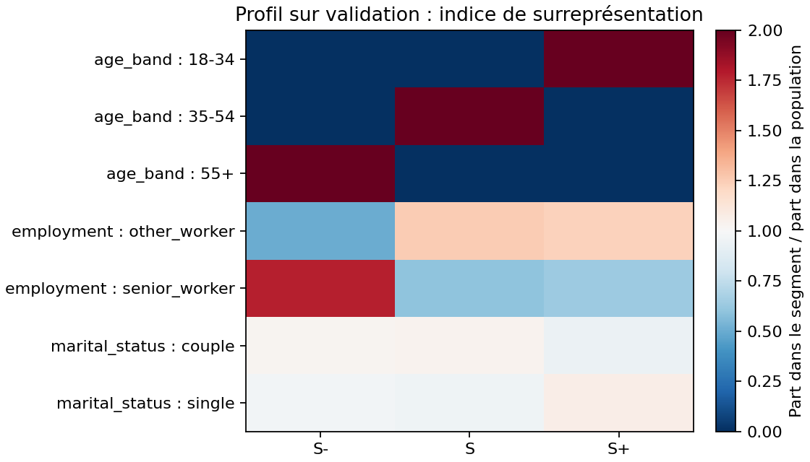

# Segmentation de la sensibilité au prix du crédit

Projet **Python sans interface** pour rechercher trois segments interprétables présentant des associations différentes entre taux proposé et booking, puis décrire leur composition. Chaque segment représente au moins 25 % des demandes d’apprentissage par défaut.

Il s’agit d’un prototype analytique reproductible, pas d’un moteur de décision tarifaire prêt à la production. Les exemples utilisent exclusivement des données synthétiques.

## Installation et exemple complet

Python 3.10 ou ultérieur :

```bash
git clone https://github.com/houalla88/credit-price-segmentation.git
cd credit-price-segmentation
python -m venv .venv
source .venv/bin/activate  # Windows : .venv\Scripts\activate
python -m pip install -e '.[dev]'
credit-segments demo --output demo.csv
credit-segments fit demo.csv --product renovation --features age_band --controls risk_score --profile age_band employment marital_status --output results/demo
```

Le dossier de sortie doit être nouveau. Les commandes refusent d’écraser les résultats existants.

## Résultats et graphiques

| Fichier | Utilité |
|---|---|
| `model.json` | Règles figées, catégories connues, paramètres, date de séparation et empreinte SHA-256 de l’entrée |
| `report.csv` | Effectifs, parts, conversion, GNoS/demande, coefficient du taux, IC 95 %, couverture des taux et contrôles de faisabilité |
| `quality.png` | Sensibilité estimée et incertitude ; proportions train/validation avec seuil minimal |
| `economics.png` | Distributions des taux et production par demande sur validation |
| `profiles.csv` | Composition détaillée de chaque segment et surreprésentation de chaque catégorie |
| `profiles.png` | Carte des indices de surreprésentation sur validation |
| `profiles.md` | Description chiffrée des principales caractéristiques des segments |
| `assignments.csv` | Identifiant, échantillon et segment ; aucune copie des données personnelles complètes |

Exemples générés :





### Comprendre le profil d’un segment

Pour chaque variable et catégorie, le code calcule :

- la proportion dans le segment et dans la population de validation ;
- la différence en points de pourcentage ;
- l’indice de surreprésentation : proportion du segment / proportion de la population.

Par exemple, 60 % de travailleurs seniors dans un segment contre 30 % dans la population donnent un indice de 2. Une catégorie surreprésentée n’est pas nécessairement majoritaire. Le résumé retient jusqu’à cinq catégories avec au moins dix observations et un écart de cinq points. Il ne s’agit pas d’un test statistique de significativité.

Les descriptions sont **marginales** : « plus de seniors » et « plus de célibataires » ne signifient pas automatiquement « plus de seniors célibataires ». Étudier cette intersection demande de fournir une colonne croisée distincte. Les variables `--profile` peuvent décrire les groupes sans participer à leur construction.

## Format des données

Une ligne = une demande, y compris refus et abandons. CSV UTF-8, séparateur virgule.

| Colonne | Format et définition |
|---|---|
| `application_id` | Identifiant unique non manquant |
| `date` | Date analysable, utilisée pour la séparation temporelle |
| `product` | Produit sélectionné avec `--product` |
| `approved` | 0/1 : décision d’octroi |
| `booked` | 0/1 : crédit financé ; nécessite `approved=1` |
| `rate_pp` | Taux en pourcentage : **7.5 signifie 7,5 %**, pas 0.075 |
| `gnos` | Production non négative, nulle si non financé ; unité cohérente sur tout le fichier |
| Variables `--features` | Catégories autorisées à définir les règles ; valeurs absentes traitées explicitement |
| Variables `--controls` | Contrôles numériques finis, disponibles au moment de l’offre |
| Variables `--profile` | Catégories descriptives, avec ou sans rôle dans les règles |

Les variables continues de segmentation ou de profil doivent être discrétisées en amont (par exemple `age_band`). Maximum huit catégories par variable de segmentation et 150 règles candidates au total pour borner le coût de recherche. Les contrôles doivent être numériques, sans valeurs manquantes, sans colinéarité exacte ; encoder et documenter les contrôles catégoriels en amont.

Le prototype exige un taux numérique sur chaque ligne. Si les demandes refusées n’ont aucun taux proposé, définir en amont une cohorte documentée avec taux disponible ; **ne pas inventer de taux ni remplacer les valeurs absentes par zéro**. Documenter la différence avec la population initiale.

## Méthode

1. Filtrer le produit et séparer chronologiquement : environ 70 % d’apprentissage et 30 % de validation. Une même date reste intégralement d’un seul côté.
2. Énumérer les règles catégorielles et les arbres binaires à deux divisions, donc trois feuilles. La recherche est exhaustive dans cette famille limitée, pas parmi toutes les partitions possibles.
3. Estimer, dans chaque feuille, un **modèle linéaire de probabilité OLS avec covariance HC3**, sur les offres approuvées uniquement : `booked ~ constante + rate_pp + contrôles`.
4. Rejeter les partitions dont une feuille représente moins de 25 % de toutes les demandes d’apprentissage, contient moins de 50 offres approuvées, manque de variation de booking, présente une matrice de régression singulière ou un écart-type des taux inférieur à 0,15 point.
5. Maximiser la somme des écarts au carré entre les trois coefficients du taux. Trier les coefficients du moins négatif au plus négatif : `S-`, `S`, `S+`.
6. Figer les règles et labels, puis réestimer et décrire les groupes sur validation sans les réoptimiser.

Un coefficient de -0,04 signifie une association de **-4 points de probabilité de booking pour +1 point de taux**, conditionnellement aux contrôles, dans les offres approuvées. Ce n’est pas une élasticité. Les différences ne sont pas déclarées statistiquement significatives automatiquement. Les labels sont relatifs : si les coefficients sont positifs ou leur ordre s’inverse en validation, ils ne démontrent pas les sensibilités attendues.

La contrainte de taille concerne toutes les demandes, tandis que la pente commerciale concerne les seules offres approuvées. Les refus ne sont donc pas interprétés comme des réactions au prix. La conversion et le GNoS par demande portent sur toutes les demandes du segment.

Le modèle linéaire rend les coefficients comparables, mais n’impose pas de probabilités entre 0 et 1. Le projet n’expose pas de prédiction de probabilité ni de simulation de prix avec ce modèle.

## Utilisation sur vos données

```bash
credit-segments fit data/applications.csv \
  --product renovation \
  --features housing_status employment \
  --controls risk_score requested_amount duration_months \
  --profile age_band employment marital_status housing_status \
  --min-share 0.25 --min-approved 100 --min-rate-std 0.20 \
  --train-fraction 0.7 --output results/renovation_v1
```

Pour comparer plusieurs segmentations, relancer avec des ensembles de variables différents et des dossiers distincts. Comparer les rapports et graphiques avec un protocole défini à l’avance. Si la validation sert à sélectionner entre plusieurs configurations, réserver ensuite une troisième période indépendante à l’évaluation finale.

Affecter de nouvelles demandes sans réentraînement :

```bash
credit-segments predict data/new_applications.csv --model results/renovation_v1/model.json --output new_segments.csv
```

Les nouvelles demandes doivent contenir `application_id`, `product` et les variables de segmentation. Les catégories inconnues suivent la branche complémentaire et génèrent un avertissement : surveiller ce phénomène avant toute utilisation opérationnelle. Le modèle est un JSON lisible, sans désérialisation de pickle.

## Interpréter la qualité

Sur validation, vérifier `estimate_ok`, `share_ok`, les intervalles, l’ordre des coefficients, les plages de taux et les proportions des groupes. Le seuil de 25 % est garanti à l’apprentissage seulement. Un échec sur validation reste visible ; les règles ne sont pas modifiées pour le masquer. La présence de chaque segment et un volume élevé ne suffisent pas à établir une séparation statistiquement robuste.

Les IC HC3 ne corrigent pas la sélection de la meilleure partition sur apprentissage. La validation indépendante réduit ce biais, mais HC3 suppose des observations indépendantes : demandes répétées d’un même client, effets temporels et chocs communs nécessitent une adaptation (séparation par client, erreurs groupées ou bootstrap par blocs). L’incertitude de sélection des règles n’est pas estimée. La recherche n’optimise pas directement la précision des coefficients.

Un traitement des taux endogènes, l’étude du recouvrement conditionnel, une identification causale, des audits d’équité, des tests de stabilité par rééchantillonnage et l’analyse du défaut à maturité comparable restent à ajouter selon le cas réel. Les caractéristiques personnelles de démonstration illustrent la méthode ; leur admissibilité pour construire une segmentation ou différencier les tarifs doit être évaluée avant utilisation. Les profils peuvent rester purement descriptifs.

Ne jamais publier les CSV réels, identifiants clients ou résultats confidentiels. `data/`, `results/`, les CSV et fichiers d’environnement sont ignorés par Git par défaut. Cela ne remplace pas la revue des fichiers avant publication.

## Version notebook : delta de GNoS entre deux périodes

`notebooks/segmentation_delta_gnos.ipynb` propose une approche **plus simple et indépendante** du script `credit-segments` :

1. Croisement des variables sociodémographiques choisies, en nombre libre. Chaque combinaison de modalités forme une cellule.
2. Delta de GNoS par cellule entre une période AVANT et une période APRÈS le changement de prix.
3. Recherche exhaustive des deux coupures, sur les cellules triées par delta, qui **maximisent l'écart entre les deltas** des trois segments S+, S et S-.
   Chaque segment doit être **suffisamment alimenté** : part minimale de la population et effectif minimal dans chaque période.
4. Tableau de bord avant/après, intervalles bootstrap, test de permutation, placebo, composition des segments et texte agrégé prêt à coller dans un LLM.

```bash
python -m pip install -e '.[notebook]'
jupyter lab notebooks/segmentation_delta_gnos.ipynb
```

Seule la cellule **Paramètres** est à modifier. Elle explique aussi la correspondance avec les options de l'ancien script.
Ces options n'existent plus dans le notebook : `--controls` et `--min-rate-std` servaient uniquement à la régression.
La logique se trouve dans `src/credit_segments/delta.py`, testée dans `tests/test_delta.py`.
Les exports, qui ne contiennent que des agrégats, sont écrits dans `results/`, ignoré par Git.

## Développement

```bash
python -m pip install -e '.[dev]'
pytest -q
ruff check .
```

Les tests vérifient les contraintes, l’absence de fuite temporelle vers les règles, l’ordre attendu sur données synthétiques, les profils, les graphiques et plusieurs entrées invalides. GitHub Actions exécute les contrôles sur Python 3.10 et 3.12.

Code fourni pour étude et adaptation. Aucune licence de réutilisation n’est imposée dans cette première version ; ajouter la licence choisie avant d’autoriser explicitement sa redistribution.
